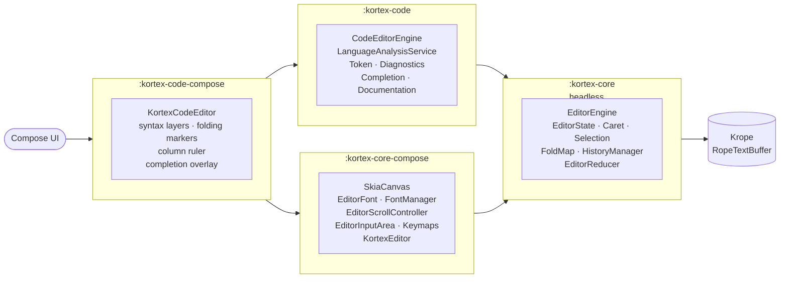

# Kortex

[](https://central.sonatype.com/search?q=io.github.numq.kortex)
[](https://kotlinlang.org/docs/multiplatform.html)
[](https://www.jetbrains.com/lp/compose-multiplatform/)
[](https://skia.org/)
[](LICENSE)

**Kortex** is an ultra-fast, hardware-accelerated code and text editor component built for **Kotlin Multiplatform** and
**Compose Multiplatform** (targeting Desktop JVM, Android, iOS, and WebAssembly / WASM-JS).

Engineered from the ground up for high throughput, sub-millisecond input latency, and locked 60+ FPS scrolling across
massive documents, Kortex bypasses standard composable layout tree overhead by coupling a **persistent Red-Black Rope
text buffer ([`Krope`](https://github.com/numq/krope))** directly with a custom **virtualized Skia/Skiko direct-canvas
rendering pipeline** and a deterministic **unidirectional MVI state reducer**.

---

## Table of Contents

- [Why Kortex?](#why-kortex)
- [Key Features](#key-features)
- [Architecture & Design Principles](#architecture--design-principles)
- [Module Structure](#module-structure)
- [Supported Platforms](#supported-platforms)
- [Gradle Installation](#gradle-installation)
- [Quick Start Guide](#quick-start-guide)
    - [1. Core Plain Text Editor (`KortexEditor`)](#1-core-plain-text-editor-kortexeditor)
    - [2. Full IDE Code Editor (`KortexCodeEditor`)](#2-full-ide-code-editor-kortexcodeeditor)
- [Deep Dive & Customization](#deep-dive--customization)
    - [Language Analysis Service (`LanguageAnalysisService`)](#language-analysis-service-languageanalysisservice)
        - [Syntax Highlighting (`TokenProvider`)](#syntax-highlighting-tokenprovider)
        - [Code Diagnostics & Squiggle Rendering (
          `DiagnosticsProvider`)](#code-diagnostics--squiggle-rendering-diagnosticsprovider)
        - [IntelliSense Code Completion (`CompletionProvider`)](#intellisense-code-completion-completionprovider)
        - [Documentation Popups (`DocumentationProvider`)](#documentation-popups-documentationprovider)
    - [Theming & Hierarchical Scopes](#theming--hierarchical-scopes)
    - [Custom Keymap DSL & Context Actions](#custom-keymap-dsl--context-actions)
    - [Viewport Virtualization & Code Folding (`FoldMap`)](#viewport-virtualization--code-folding-foldmap)
    - [History Management & Smart Undo/Redo Merging](#history-management--smart-undoredo-merging)
    - [Multi-Cursor & Selection Normalization](#multi-cursor--selection-normalization)
    - [Desktop Integration (Scrollbars & Context Menu)](#desktop-integration-scrollbars--context-menu)
- [Architecture & API Cheatsheet](#architecture--api-cheatsheet)
- [License](#license)

---

## Why Kortex?

Standard text composables in declarative frameworks (like Jetpack Compose `BasicTextField` or `BasicTextField2`)
represent text through nested UI nodes, complex layout measurers, and frequent heap allocations during typing or
scrolling. When handling source files with tens of thousands of lines, multi-cursors, syntax highlighting, or rapid
typing, this architecture inevitably suffers from GC pauses, frame drops, and latency spikes.

**Kortex eliminates this overhead:**

- **No Composable-Per-Line**: Text layout, line numbers, selection highlights, carets, diagnostic squiggles, and indent
  guides are rendered in unified, virtualized drawing passes directly to a Skia `Canvas`.
- **Logarithmic Text Mutations**: Backed by **Krope**, text operations (insert, delete, slice, batch) run
  in $O (\log N)$ time with persistent structural sharing and zero full-buffer copies.
- **Pure Deterministic Reducer Loop**: UI events never mutate internal state directly. Everything passes through a
  thread-safe unidirectional MVI loop (`(EditorState, EditorAction) -> EditorResult`).
- **Zero-Allocation Hot Paths**: Skia `Paragraph`, `TextLine`, and `Paint` objects are managed by thread-safe,
  size-bounded LRU caches.

---

## Key Features

- ⚡ **Direct Skia Hardware Acceleration**: Bypasses Compose UI node overhead using Skiko canvas operations
  (`drawWithCache`, `nativeCanvas`, `SkikoSurfaceView`).
- 🌲 **Backed by Krope Buffer**: Instantaneous navigation and edits on 100K+ line documents with sub-millisecond
  execution.
- 👥 **Native Multi-Cursor & Multi-Selection**: Fully interactive multiple carets via `Alt + Click`, `Alt + Drag`, and VS
  Code-style `Select Next Match` (`Ctrl+D` / `Cmd+D`) with automatic overlap coalescing.
- 🎨 **Hierarchical Token Theming**: Flexible syntax theming with automatic dot-separated fallback resolution (e.g.,
  `keyword.control` automatically falls back to `keyword`).
- 🔍 **Language Tooling Engine**:
    - Asynchronous, debounced tokenization pipeline (50ms debounce).
    - Background diagnostics engine (300ms debounce) with sine-wave / zigzag squiggle rendering for Errors, Warnings,
      Information, and Hints.
    - Floating auto-completion popup with keyboard navigation (`Up`/`Down`, `Enter`/`Tab`, `Escape`).
    - Hover documentation resolution via `DocumentationProvider` (debounced at 250ms, resolved against the caret
      offset).
    - Active caret symbol occurrence highlighting.
- 📂 **Logarithmic Code Folding (`FoldMap`)**: Cumulative line interval trees delivering $O (\log K)$ binary search
  conversions between document lines and visual lines.
- ⏱️ **Debounced Undo/Redo History**: Automatic contiguous typing/backspacing grouping within a 700ms sliding window
  with exact selection and cursor restoration.
- ⌨️ **Extensible Keymap DSL**: Modular shortcut configuration with platform-aware primary modifiers (`Ctrl` on
  Linux/Windows, `Cmd` on macOS) and read-only protections.
- 🖥️ **Desktop-Ready UX**: Native Compose scrollbar adapters, right-click contextual menu (Cut, Copy, Paste, Undo, Redo,
  Select All), column rulers, and line gutter events.

---

## Architecture & Design Principles



1. **Unidirectional State Flow**: The UI observes an immutable `StateFlow<EditorState>` or `StateFlow<CodeEditorState>`.
   UI gestures emit actions, which reducers map to state updates and side-effect commands (`EditorCommand.ApplyText`,
   `Undo`, `Redo`).
2. **Buffer / State Decoupling**: Text mutations are dispatched as `TextOperation.Data` to `RopeTextBuffer`. Edit deltas
   (`TextEdit.Data`) map back through surviving selections and carets without shifting or desynchronizing editor state.
3. **Multi-Level LRU Cache System**: Bounded LRU caches for `Paragraph`, `TextLine`, and `Paint` prevent GC pressure and
   allocations during continuous 60 FPS scrolling and fast typing.

| Cache                | Default capacity | Key                                           |
|----------------------|------------------|-----------------------------------------------|
| `ParagraphCache`     | 1000             | `(text, font, textColor)`                     |
| `CodeParagraphCache` | 1000             | `(line, text, tokens, font, syntaxTheme)`     |
| `TextLineCache`      | 1000             | `(text, font)` — used for gutter line numbers |
| `PaintCache`         | 1000             | `(color, isAntiAlias, mode, strokeWidth)`     |

All caches implement `LruCache` and are closed automatically when the composable leaves composition (`DisposableEffect`
in `rememberLayerFactory` / `rememberCodeLayerFactory`).

---

## Module Structure

| Module                 | Maven Artifact                                 | Description                                                                                                                                                       |
|------------------------|------------------------------------------------|-------------------------------------------------------------------------------------------------------------------------------------------------------------------|
| `:kortex-core`         | `io.github.numq.kortex:core:<version>`         | Headless editor primitives: `EditorEngine`, `EditorState`, `Caret`, `Selection`, `FoldMap`, `HistoryManager`, and functional reducers. Zero Compose dependencies. |
| `:kortex-core-compose` | `io.github.numq.kortex:core-compose:<version>` | Skia canvas rendering integration (`SkiaCanvas`), `EditorFont`, `FontManager`, `EditorScrollController`, `EditorInputArea`, keymaps, and default context menus.   |
| `:kortex-code`         | `io.github.numq.kortex:code:<version>`         | Code abstractions: `CodeEditorEngine`, `LanguageAnalysisService`, tokenization models, diagnostics, occurrence tracking, documentation, and completion.           |
| `:kortex-code-compose` | `io.github.numq.kortex:code-compose:<version>` | High-level `KortexCodeEditor` composable, syntax highlighting layers, folding markers, column ruler, and code completion overlays.                                |

---

## Supported Platforms

Kortex leverages Kotlin Multiplatform and Skiko/Skia bindings:

| Platform          | Target Identifier                         | Architecture / Runtime                                |
|-------------------|-------------------------------------------|-------------------------------------------------------|
| **JVM (Desktop)** | `jvm`                                     | macOS, Windows, Linux (Java 17+)                      |
| **Android**       | `android`                                 | API 24+ via `SkikoSurfaceView`                        |
| **iOS**           | `iosX64`, `iosArm64`, `iosSimulatorArm64` | Native Skia canvas rendering                          |
| **WebAssembly**   | `wasmJs`                                  | Modern browsers supporting WebAssembly & WebGL/WebGPU |

---

## Gradle Installation

Add `mavenCentral()` to your repositories:

```kotlin
repositories {
    mavenCentral()
}
```

Add dependencies to your `build.gradle.kts` in your multiplatform `commonMain` or platform source sets:

```kotlin
dependencies {
    // Core text manipulation engine (Headless)
    implementation("io.github.numq.kortex:core:1.1.0")

    // Compose Multiplatform basic Skia text editor
    implementation("io.github.numq.kortex:core-compose:1.1.0")

    // Code editor engine & language analysis abstractions
    implementation("io.github.numq.kortex:code:1.1.0")

    // Complete Compose Multiplatform IDE code editor (Includes syntax, folding, completions)
    implementation("io.github.numq.kortex:code-compose:1.1.0")

    // Krope buffer dependency (Required for buffer initialization)
    implementation("io.github.numq.krope:text:1.1.1")
}
```

---

## Quick Start Guide

### 1. Core Plain Text Editor (`KortexEditor`)

> Requires `:kortex-core-compose` (and `:kortex-core` transitively).

If you need a lightweight, high-performance text buffer editor without code-specific tooling:

```kotlin
import androidx.compose.foundation.layout.fillMaxSize
import androidx.compose.runtime.*
import androidx.compose.ui.Modifier
import io.github.numq.kortex.core.EditorEngine
import io.github.numq.kortex.core.compose.KortexEditor
import io.github.numq.kortex.core.compose.font.EditorFont
import io.github.numq.kortex.core.compose.theme.EditorTheme
import io.github.numq.krope.core.Encoding
import io.github.numq.krope.text.RopeTextBuffer
import io.github.numq.krope.text.TextLineEnding
import org.jetbrains.skia.FontMgr
import org.jetbrains.skia.FontStyle
import org.jetbrains.skia.Typeface

@Composable
fun SimpleEditor() {
    val scope = rememberCoroutineScope()

    val buffer = remember {
        RopeTextBuffer(
            initialText = "Welcome to Kortex Plain Text Editor!",
            initialLineEnding = TextLineEnding.LF,
            initialEncoding = Encoding.UTF8,
            enablePooling = true
        )
    }

    val engine = remember(buffer) { EditorEngine(scope = scope, buffer = buffer) }

    val font = remember {
        val typeface = FontMgr.default.matchFamilyStyle("JetBrains Mono", FontStyle.NORMAL)
            ?: FontMgr.default.matchFamilyStyle(null, FontStyle.NORMAL)
            ?: Typeface.makeEmpty()

        EditorFont(typeface = typeface, size = 14f, lineSpacing = 1.2f)
    }

    DisposableEffect(font) {
        onDispose {
            font.close()
        }
    }

    val colorScheme = androidx.compose.material3.MaterialTheme.colorScheme
    val theme = remember(colorScheme) {
        EditorTheme.fromColorScheme(colorScheme)
    }

    KortexEditor(engine = engine, font = font, theme = theme, modifier = Modifier.fillMaxSize())
}
```

---

### 2. Full IDE Code Editor (`KortexCodeEditor`)

> Requires `:kortex-code-compose` (pulls `:kortex-code` and `:kortex-core-compose` transitively).

Setting up `KortexCodeEditor` with line numbers, code folding, scrollbars, and syntax rendering:

```kotlin
import androidx.compose.foundation.HorizontalScrollbar
import androidx.compose.foundation.VerticalScrollbar
import androidx.compose.foundation.isSystemInDarkTheme
import androidx.compose.foundation.layout.*
import androidx.compose.material3.MaterialTheme
import androidx.compose.material3.darkColorScheme
import androidx.compose.material3.lightColorScheme
import androidx.compose.runtime.*
import androidx.compose.ui.Alignment
import androidx.compose.ui.Modifier
import androidx.compose.ui.platform.LocalDensity
import io.github.numq.kortex.code.CodeEditorEngine
import io.github.numq.kortex.code.analysis.LanguageAnalysisService
import io.github.numq.kortex.code.compose.KortexCodeEditor
import io.github.numq.kortex.code.compose.theme.CodeEditorTheme
import io.github.numq.kortex.core.EditorEngine
import io.github.numq.kortex.core.compose.font.EditorFont
import io.github.numq.kortex.core.compose.scroll.rememberEditorScrollController
import io.github.numq.kortex.core.compose.scrollbar.rememberHorizontalScrollbarAdapter
import io.github.numq.kortex.core.compose.scrollbar.rememberVerticalScrollbarAdapter
import io.github.numq.krope.core.Encoding
import io.github.numq.krope.text.RopeTextBuffer
import io.github.numq.krope.text.TextLineEnding
import org.jetbrains.skia.FontMgr
import org.jetbrains.skia.FontStyle
import org.jetbrains.skia.Typeface

@Composable
fun FullCodeEditorScreen() {
    val scope = rememberCoroutineScope()

    // 1. Persistent Krope buffer
    val buffer = remember {
        RopeTextBuffer(
            initialText = """
                package example

                fun main() {
                    println("Hello from Kortex Skia Code Editor!")
                }
            """.trimIndent(),
            initialLineEnding = TextLineEnding.LF,
            initialEncoding = Encoding.UTF8,
            enablePooling = true
        )
    }

    // 2. Instantiate engines
    val editorEngine = remember(buffer) { EditorEngine(scope = scope, buffer = buffer) }
    val codeEngine = remember(editorEngine) {
        CodeEditorEngine(
            scope = scope,
            engine = editorEngine,
            analysisService = object : LanguageAnalysisService {} // Plug custom analysis here
        )
    }

    // 3. Configure typography & theme
    val font = remember {
        val typeface = FontMgr.default.matchFamilyStyle("JetBrains Mono", FontStyle.NORMAL)
            ?: FontMgr.default.matchFamilyStyle(null, FontStyle.NORMAL)
            ?: Typeface.makeEmpty()
        EditorFont(typeface = typeface, size = 14f, lineSpacing = 1.25f)
    }

    DisposableEffect(font) {
        onDispose {
            font.close()
        }
    }

    val isDark = isSystemInDarkTheme()
    val colorScheme = if (isDark) darkColorScheme() else lightColorScheme()
    val theme = remember(colorScheme, isDark) { CodeEditorTheme.fromColorScheme(colorScheme, isDark) }
    val scrollController = rememberEditorScrollController()

    MaterialTheme(colorScheme = colorScheme) {
        Box(modifier = Modifier.fillMaxSize()) {
            KortexCodeEditor(
                engine = codeEngine,
                font = font,
                theme = theme,
                scrollController = scrollController,
                columnRuler = 80,
                modifier = Modifier.fillMaxSize()
            )

            // Desktop vertical scrollbar
            if (scrollController.canScrollVertically) {
                VerticalScrollbar(
                    adapter = rememberVerticalScrollbarAdapter(scrollController),
                    modifier = Modifier.align(Alignment.CenterEnd).fillMaxHeight()
                )
            }

            // Desktop horizontal scrollbar aligned with text content area
            if (scrollController.canScrollHorizontally) {
                val density = LocalDensity.current
                val gutterPadding = with(density) { scrollController.gutterWidth.toDp() }
                HorizontalScrollbar(
                    adapter = rememberHorizontalScrollbarAdapter(scrollController),
                    modifier = Modifier
                        .align(Alignment.BottomStart)
                        .fillMaxWidth()
                        .padding(start = gutterPadding)
                )
            }
        }
    }
}
```

---

## Deep Dive & Customization

### Language Analysis Service (`LanguageAnalysisService`)

To equip Kortex with syntax highlighting, diagnostics, autocompletion, and hover information, provide an implementation
of `LanguageAnalysisService`:

```kotlin
val customLanguageService = object : LanguageAnalysisService {
    override val tokenProvider = TokenProvider { snapshot, range ->
        // Return Map<Int, List<Token>> (Key = Line Index)
        // Executed asynchronously in background (debounced at 50ms)
        parseSyntaxTokens(snapshot, range)
    }

    override val diagnosticsProvider = DiagnosticsProvider { snapshot ->
        // Return List<CodeIssue>
        // Executed asynchronously in background (debounced at 300ms)
        runLinter(snapshot)
    }

    override val completionProvider = CompletionProvider { snapshot, offset ->
        // Return List<CodeSuggestion>
        // Triggered via Ctrl+Space / Cmd+Space or typing triggers
        computeAutocompletions(snapshot, offset)
    }

    override val documentationProvider = DocumentationProvider { snapshot, offset ->
        // Return CodeDocumentation(content, range)
        computeHoverDocumentation(snapshot, offset)
    }
}
```

> Debounce intervals (50ms for tokens, 300ms for diagnostics, 250ms for documentation) are managed in`CodeEditorEngine`.
> Providers run on `Dispatchers.Default` and receive the latest `TextSnapshot` revision only -
> stale results are dropped via `distinctUntilChangedBy(TextSnapshot::revision)`.

#### Syntax Highlighting (`TokenProvider`)

Tokens are mapped by zero-based line indices using `TextRange` and `TokenType`:

```kotlin
// A TokenProvider receives `range = null` (whole document) or a specific TextRange
// for incremental re-tokenization after an edit.

val token = Token(
    range = TextRange(
        start = TextPosition(line = 0, column = 0),
        end = TextPosition(line = 0, column = 7)
    ),
    type = TokenType.KEYWORD
)
```

Built-in token types include:

- `TokenType.KEYWORD`, `TokenType.KEYWORD_CONTROL`
- `TokenType.TYPE`, `TokenType.TYPE_BUILTIN`
- `TokenType.FUNCTION`, `TokenType.FUNCTION_METHOD`
- `TokenType.VARIABLE`, `TokenType.VARIABLE_PARAMETER`
- `TokenType.STRING`, `TokenType.NUMBER`
- `TokenType.COMMENT`, `TokenType.COMMENT_LINE`, `TokenType.COMMENT_BLOCK`
- `TokenType.OPERATOR`, `TokenType.PUNCTUATION`, `TokenType.PUNCTUATION_BRACKET`, `TokenType.PUNCTUATION_DELIMITER`
- `TokenType.MARKUP_LINK`, `TokenType.DEFAULT`

#### Code Diagnostics & Squiggle Rendering (`DiagnosticsProvider`)

Issues are rendered as smooth, high-precision sine-wave underline paths on the Skia canvas:

```kotlin
val compilerError = CodeIssue.Error(
    range = TextRange(
        start = TextPosition(line = 1, column = 4),
        end = TextPosition(line = 1, column = 16)
    ),
    message = "Unresolved reference: unresolvedMethod",
    source = "Compiler",
    code = "E0042"
)
```

Available issue types: `CodeIssue.Error`, `CodeIssue.Warning`, `CodeIssue.Information`, `CodeIssue.Hint`,
`CodeIssue.Unknown`.

#### IntelliSense Code Completion (`CompletionProvider`)

```kotlin
val suggestion = CodeSuggestion(
    label = "calculateMetrics(buffer)",
    kind = CodeSuggestion.Kind.FUNCTION,
    text = "calculateMetrics()",
    detail = "Result",
    documentation = "Analyzes the persistent rope buffer and computes structural metrics."
)
```

If `range` is provided, applying the suggestion **replaces** that range (useful for partial word completion); otherwise
it **inserts** `text` at the caret anchor. This is handled by `CodeEditorAction.Completion.Apply` →
`TextOperation.Data.Single.Replace` / `.Insert`.

Popup controls when visible:

- `DirectionDown` / `DirectionUp`: Navigate items.
- `Enter` / `Tab`: Apply selected completion.
- `Escape`: Dismiss overlay.

#### Documentation Popups (`DocumentationProvider`)

```kotlin
val docs = CodeDocumentation(
    content = "RopeTextBuffer: Thread-safe, balanced Red-Black tree buffer.",
    // `range` is optional - omit it to attach documentation to the whole document
    range = TextRange(
        start = TextPosition(line = 0, column = 5),
        end = TextPosition(line = 0, column = 19)
    )
)
```

---

### Theming & Hierarchical Scopes

Kortex themes use a hierarchical dot-separated resolver. When styling `keyword.control`, if no explicit style exists, it
automatically inherits from `keyword`:

```kotlin
val mySyntaxTheme = SyntaxTheme.build(
    defaultText = Color(0xFFABB2BF)
) {
    put(TokenType.KEYWORD.name, Color(0xFFC678DD))
    put(TokenType.KEYWORD_CONTROL.name, Color(0xFFE06C75))
    put(TokenType.FUNCTION.name, Color(0xFF61AFEF))
    put(TokenType.STRING.name, Color(0xFF98C379))
    put(TokenType.NUMBER.name, Color(0xFFD19A66))
    put(TokenType.COMMENT.name, Color(0xFF5C6370))
}

val editorTheme = CodeEditorTheme(
    editor = EditorTheme.fromColorScheme(colorScheme),
    syntax = mySyntaxTheme,
    diagnostics = DiagnosticsTheme(
        error = Color(0xFFE06C75),
        warning = Color(0xFFE5C07B),
        info = Color(0xFF61AFEF),
        hint = Color(0xFF5C6370)
    ),
    occurrences = OccurrencesTheme(
        matchBackground = Color(0xFF3E4451).copy(alpha = 0.5f),
        currentMatchBackground = Color(0xFF528BFF).copy(alpha = 0.4f)
    ),
    folding = FoldingTheme(
        iconColor = Color(0xFF61AFEF)
    ),
    ruler = Color(0xFF3E4451).copy(alpha = 0.3f)
)
```

---

### Custom Keymap DSL & Context Actions

Extend or customize keyboard behaviors using `buildEditorKeymap`:

```kotlin
val myCustomKeymap = buildEditorKeymap(baseKeymap = DefaultCodeEditorKeymap.create(codeEngine)) {
    // Quick Save: Ctrl+S / Cmd+S
    bind(Key.S, primary = true, description = "Save File") {
        val content = state.snapshot.text
        saveToFile(content)
    }

    // Move current line up: Alt+Up
    bind(Key.DirectionUp, alt = true, requiresEditable = true, description = "Move Line Up") {
        dispatch(EditAction.MoveLineUp)
    }

    // Format document: Ctrl+Alt+L
    bind(Key.L, primary = true, alt = true, requiresEditable = true, description = "Reformat Code") {
        formatSource()
    }
}
```

#### Default Shortcut Cheat Sheet

| Shortcut (PC / Mac)              | Action Description                                         |
|----------------------------------|------------------------------------------------------------|
| `Ctrl+A` / `Cmd+A`               | Select entire document                                     |
| `Ctrl+D` / `Cmd+D`               | Select word / Add next occurrence match (**Multi-Cursor**) |
| `Alt + Click / Drag`             | Add independent cursor / rectangular selection drag        |
| `Ctrl+Z` / `Cmd+Z`               | Undo                                                       |
| `Ctrl+Shift+Z` / `Cmd+Shift+Z`   | Redo                                                       |
| `Ctrl+C` / `Ctrl+X` / `Ctrl+V`   | Copy / Cut / Paste (works with multi-cursors)              |
| `Ctrl+Shift+D`                   | Duplicate current line or selection                        |
| `Alt + Up / Down`                | Move current line or block up / down                       |
| `Tab` / `Shift+Tab`              | Indent / Unindent selected block or insert soft tabs       |
| `Ctrl+/` / `Cmd+/`               | Toggle line comment (`// `)                                |
| `Ctrl+Space`                     | Request IntelliSense code completion                       |
| `Ctrl+Backspace` / `Ctrl+Delete` | Delete word left / right                                   |
| `Home` / `End`                   | Smart move to indent start / line end                      |
| `Ctrl+Home` / `Ctrl+End`         | Move to document start / document end                      |
| `PageUp` / `PageDown`            | Viewport page scrolling with caret tracking                |
| `Escape`                         | Dismiss completion popup / collapse extra carets           |

---

### Viewport Virtualization & Code Folding (`FoldMap`)

Kortex easily renders files with hundreds of thousands of lines by rendering only the visible viewport slice:

```kotlin
val foldMap = state.foldMap
val visualLineIndex = foldMap.documentToVisualLine(actualDocumentLine)
val documentLineIndex = foldMap.visualToDocumentLine(visualLineIndex)
```

- **Binary Search Tree Intervals**: `FoldMap` manages collapsed regions using interval trees with $O (\log K)$ mapping.
- **Render Culling**: Collapsed lines are completely bypassed during Skia layout passes.
- **Interactive Gutters**: `KortexCodeEditor` wires gutter clicks to `ViewportAction.ToggleFolding(line)` when a
  `FoldingRegion` starts on that line. `KortexEditor` (plain text) exposes a generic `onGutterClick(line, offset)`
  callback instead — you decide what a gutter click means.

---

### History Management & Smart Undo/Redo Merging

Typing individual characters does not create hundreds of micro undo entries. `HistoryManager` automatically merges edits
when:

1. Edits share the same operation type (`Insert` + `Insert` or `Delete` + `Delete`).
2. Edits occur within **700ms** of each other.
3. No newline characters are added.
4. Carets remain contiguous.

Executing Undo/Redo restores both buffer contents and exact caret/selection states.

---

### Multi-Cursor & Selection Normalization

Add multiple cursors programmatically or interactively:

```kotlin
// Add cursor at specific location
editorEngine.dispatch(CaretAction.AddCursor(TextPosition(line = 10, column = 4)))

// Add next match to selection
editorEngine.dispatch(SelectionAction.SelectNextMatch)
```

`SelectNextMatch` behaves like VS Code's `Ctrl+D`:

- With an empty selection, it selects the word under the caret.
- Otherwise, it searches forward from `primary.range.end`, wrapping to the start of the document.
- Duplicate matches are coalesced automatically, so repeatedly pressing `Ctrl+D` advances to the next distinct
  occurrence.

- **Selection Normalization**: Overlapping carets and ranges are automatically merged into clean, non-intersecting
  intervals via `Selection.normalize()`.
- **Direction Awareness**: Preserves anchor and caret orientations (`FORWARD` / `BACKWARD`).
- **Sticky Column Navigation**: Preserves original column offsets when navigating vertically across uneven lines.

---

### Desktop Integration (Scrollbars & Context Menu)

Kortex provides adapters for Compose Desktop scrollbars:

- `EditorScrollController.asVerticalScrollbarAdapter()` / `rememberVerticalScrollbarAdapter(...)`
- `EditorScrollController.asHorizontalScrollbarAdapter()` / `rememberHorizontalScrollbarAdapter(...)`

A built-in Material 3 right-click context menu handles Cut, Copy, Paste, Undo, Redo, and Select All out of the box.

---

## Architecture & API Cheatsheet

### Core Types

| Class / Interface        | Responsibility                                                                                          |
|--------------------------|---------------------------------------------------------------------------------------------------------|
| `EditorEngine`           | Coordinates text buffer operations, history tracking, and reducer dispatch loops.                       |
| `CodeEditorEngine`       | Extends `EditorEngine` with asynchronous debounced language analysis pipelines.                         |
| `EditorConfig`           | Immutable editor preferences: `tabSize`, `useSoftTabs`, `lineSeparator` (derived `tabString`).          |
| `EditorState`            | Immutable snapshot of text snapshot, selections, collapsed ranges, and config.                          |
| `CodeEditorState`        | Extends `EditorState` with syntax tokens, lint diagnostics, documentation, and completion state.        |
| `EditorFont`             | Thread-safe Skia typeface wrapper managing font collections, ascents, descents, and paragraph builders. |
| `EditorScrollController` | Stable controller handling viewport offsets, bounds, and auto-scrolling to carets.                      |
| `FoldMap`                | High-performance coordinate mapper between logical lines and visible lines.                             |

`EditorConfig` is passed into `EditorState.config` and can be updated at runtime via
`EditorAction.UpdateConfig(EditorConfig(tabSize = 2, useSoftTabs = true))`.

`CodeEditorState.CompletionState` is a sealed hierarchy: `Hidden` or
`Visible(suggestions: List<CodeSuggestion>, selectedIndex: Int, anchorPosition: TextPosition)`. The `selectedItem`
property resolves the currently highlighted suggestion.

### Reducer Actions

- **`EditAction`**:
  `Insert`, `Paste`, `Enter`, `Tab`, `Untab`, `Backspace`, `Delete`, `WordDeleteLeft`, `WordDeleteRight`, `MoveLineUp`,
  `MoveLineDown`, `Duplicate`, `JoinLines`
- **`CaretAction`**: `Move`, `AddCursor`, `MoveLeft`, `MoveRight`, `MoveUp`, `MoveDown`, `MoveWordLeft`,`MoveWordRight`,
  `MoveLineStart`, `MoveLineEnd`, `MoveDocStart`, `MoveDocEnd`.
- **`SelectionAction`**: `Clear`, `SelectAll`, `SelectWordAt`, `SelectLine`, `SelectRange`, `AddSelection`,
  `SetSelections`, `SelectNextMatch`.
- **`ViewportAction`**: `ToggleFolding`, `UpdateCollapsedLines`, `UpdateFoldingRegions`.
- **`HistoryAction`**: `Undo`, `Redo`.
- **`CodeEditorAction`**: `Core`, `Edit.ToggleComment`, `External.UpdateSyntax`, `External.UpdateAnalysis`,
  `External.UpdateDocumentation`, `Completion.Show`, `Completion.Apply`, `Completion.ApplyAt`, `Completion.Dismiss`,
  `Completion.SelectNext`, `Completion.SelectPrevious`.

> `EditAction` and `CaretAction` mutate the buffer or selection directly. `ViewportAction` only
> rebuilds `FoldMap` (buffer is untouched). `HistoryAction` is routed as `EditorCommand.Undo/Redo`
> and replays the inverse `TextOperation.Data` recorded by `HistoryManager`.

---

## License

Apache-2.0 License - see [LICENSE](LICENSE) file for details.

---

<p align="center">
  <a href="https://numq.github.io/support">
    
  </a>
  <br>
  <a href="https://numq.github.io/support" style="text-decoration: none;">
    <code><font color="#bb9af7">Support Development: numq.github.io/support</font></code>
  </a>
</p>